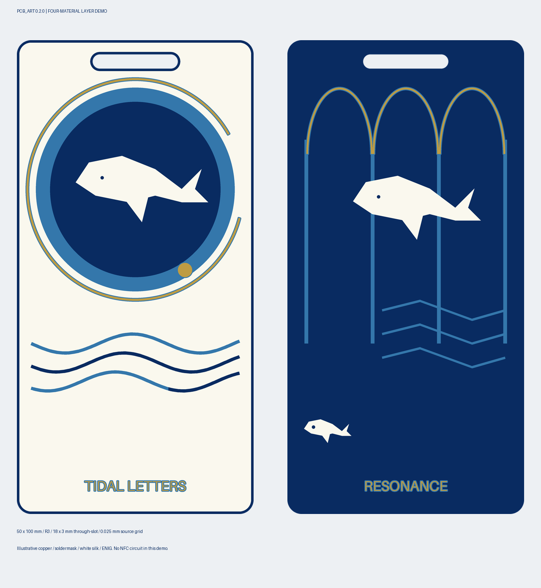
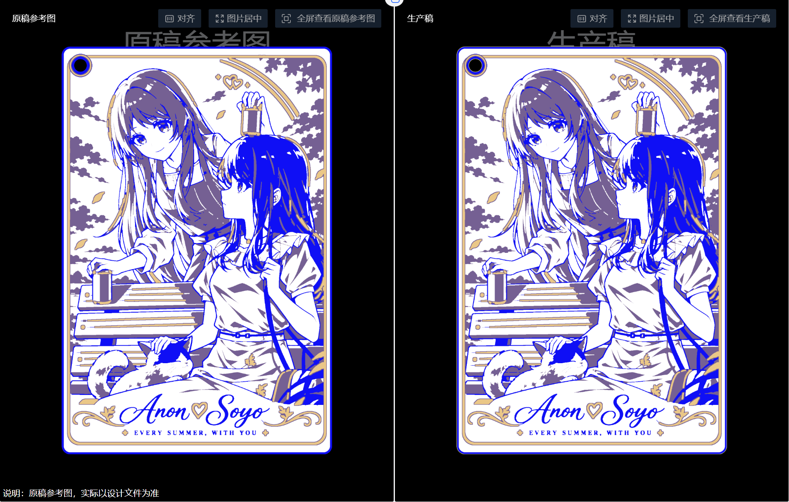
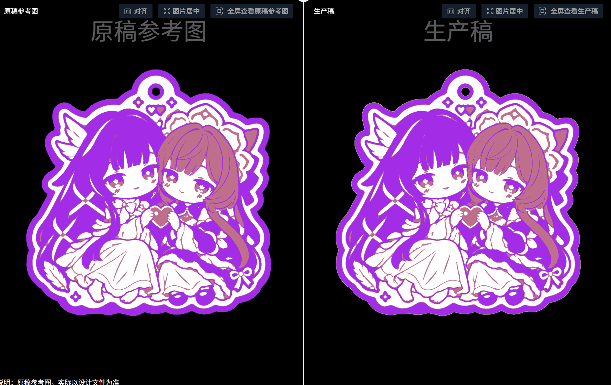

# PCB_ART · 0.2.0

把插画转译为双面 PCB 艺术画。用 **单色阻焊、覆铜、白丝印和沉金开窗** 表现材质与画面，保留五官、发束、手部、裙摆和文字的结构。提供可运行的 Python 脚本、Codex skill、KiCad 输出、原生 Gerber 导出，以及 NFC 隔离、合并与调谐分析工具。

本版将此前的文档型 skill 推进为可复现的工具。艺术方向由原稿、构图和语义区域确定，四材料分色提供初稿，保护区和显式覆盖负责关键细节。脚本不会自动识别人手、修正肢体或重画漂亮的脸，需要在母稿阶段完成这些视觉判断。

## 本版改进

- **按毫米工作**。默认示例 40 px/mm，对应 0.025 mm 网格。轮廓量化、板厂成像和实物加工是不同精度来源，网格尺寸不等于制造精度。
- **保护关键细节**。眼睛、眉毛、嘴线、额头露肤、手指、字腔可以用保护掩膜标记。去噪仅删除明确 ROI 中、面积低于阈值且未碰保护区的完整孤岛。连续轮廓和负形孔洞保留。
- **保留整体构图**。不自动裁边、缩人物、拉伸画幅。正反面共用画布，分面设计，背景用连贯层次与少量装饰组织。
- **用实际材料预览**。深蓝、浅蓝、白、金四类，另出低蓝色色差预览。主要文字可分配金色，黄金面积与铜面积分开理解。
- **槽孔真正贯穿**。顶部穿绳槽使用闭合内部 `Edge.Cuts` 轮廓。铜、开窗和丝印统一避让孔壁，并输出透明槽预览。
- **NFC 与艺术铜分开**。同一物理区域同时清除两面的装饰铜和开窗，白丝印可以保留。原生合并工具核对板框、保护功能焊盘，保持焊盘、网络和走线不变。
- **NFC 分析可追溯**。闭合真实路径、跨层回线、矩形导体 GMD、分段积分收敛、零板级寄生基线与实测改容分别记录。脚本不输出虚构扫描成功率或绝对信号 dB。

## 快速运行

Python 3.10+。在独立环境安装本仓库的依赖。

```sh
python -m venv .venv
```

先激活环境，Windows PowerShell 使用 `. .venv/Scripts/Activate.ps1`，Linux/macOS 使用 `source .venv/bin/activate`。随后运行。

```sh
python -m pip install -r requirements.txt
python examples/make_demo.py --out build/demo-source
python scripts/pcb_art.py build build/demo-source/project.json --out build/demo-result
python -m unittest discover -s tests -v
```

在 Windows 的非 UTF-8 环境下使用 `python -X utf8`。每次构建需选择新的输出目录，脚本拒绝覆盖既有修订。

示例是仓库自带的抽象鲸鱼与拱廊双面设计，50 × 100 mm、R3、顶部 18 × 3 mm 穿绳槽。这组尺寸来自本项目约定，其他作品应按其真实尺寸、保护套和挂绳调整。



示例左下留空区用于演示 NFC 艺术铜避让，白色鲸鱼图案可保留。它没有装配 NFC 电路，不能直接作为 NFC 成品。

### 导出 Gerber

使用已安装的 KiCad 9/10，先执行对应命令的 `--help` 核对当前版本。实际回归使用 KiCad 10.0.5。

```sh
python scripts/pcb_art.py gerber build/demo-result --kicad-cli /path/to/kicad-cli --out build/demo-gerber
```

该命令核对构建哈希，运行含警告和豁免的原生 DRC，导出六个艺术层及板框，生成 SHA-256 记录和 `Gerber.zip`。任何 DRC 违规都会阻止打包。艺术示例的槽为非金属化铣槽，位于板框文件，不重复生成假钻孔。**加入 NFC 电路后，按 [NFC 文档](references/nfc.md) 额外导出真实过孔钻孔文件，不能使用这个纯艺术包替代完整电路制造包。**

本地零差异和 DRC 通过分别验证图层转译与规则，独立 Gerber 几何回读、嘉立创导入、工厂 CAM、实物 NFC 读写在报告中单独标记。

## 换成自己的图片

1. 将母稿整理到同一毫米画布，先确认正反面风格、表情、手脚数量和构图。保留可编辑原稿。
2. 修改示例 `project.json`。每一面使用 `image` 提供不透明 RGB 初稿，或使用 `labels` 提供精修后的单通道标签 PNG。
3. 标签数值固定为 `0=深色阻焊`、`1=覆铜浅色阻焊`、`2=白丝印`、`3=沉金`。标签图仅含 0/1/2/3，保护掩膜及覆盖掩膜仅含 0/255，白色表示选中。
4. 为脸、头发、手、服装、文字和背景分别建立保护/覆盖区域。文字优先从可编辑矢量稿栅格化到统一网格，保留字腔和字体风格。
5. 检查正反面预览、低色差预览、语义修改差分、制造差分和细节警示图。处理规则错误，并逐处审核细节警示后再导出。

输入尺寸必须等于 `width_mm × px_per_mm`、`height_mm × px_per_mm`。脚本拒绝隐式缩放或裁切。保护、修复与清理字段的完整说明见 [脚本接口与精度](references/pipeline.md)。

### 输出

| 文件 | 用途 |
|---|---|
| `artwork.kicad_pcb` | 两面艺术层和解析板框，背面已在制造顶视坐标镜像一次 |
| `F/B_Cu.png`、`F/B_Mask.png`、`F/B_SilkS.png` | 白色为几何，均为正常观看朝向 |
| `F/B_preview.png`、`F/B_low_contrast.png` | 正常观看及低蓝色色差检查 |
| `F/B_labels.png` | 局部精修后的语义母稿，可继续编辑 |
| `F/B_materials.png` | 同一母稿的四材料 RGB 版本，便于在绘图软件中查看/编辑后以 `image` 重导入 |
| `F/B_semantic_diff.png` | 相对初始分色的显式编辑差分 |
| `F/B_manufacturing_diff.png` | 材料意图经铜裕量、丝印避让和孔位裁切后的差异 |
| `F/B_*_fine_detail.png` | 开运算提示的窄部、尖角和细节，供人工复核 |
| `report.json`、`manifest.json` | 几何检查、回读、来源哈希及验证状态 |

输出 PNG 的物理尺寸以配置为准。`Mask` 始终表示**阻焊开窗**，有铜且开窗才显示所选表面处理。盖阻焊铜的浅蓝与无铜深蓝是示意明暗，实际差别取决于油墨、铜面和光照。背景须在低色差条件下仍有结构。

## NFC 工具

```sh
# 先运行上述示例生成器，产生单匝回路的数值检查样本
python scripts/nfc_analyze.py baseline build/demo-source/loop_baseline.json --out build/loop-baseline.json
# 真实 10 匝紧凑线圈及跨层引出的匿名几何基准
python scripts/nfc_analyze.py baseline examples/compact_10turn.json --out build/compact-baseline.json
# 固定 L、芯片电容、板级 Cp 和加载条件下，从实测频率估算改容
python scripts/nfc_analyze.py retune --old-pF 27 --chip-pF 28.5 --board-pF 0 --measured-MHz 14.70 --target-MHz 13.56
```

`baseline` 显式令板级寄生电容为零、外部装饰铜缺席，芯片内部电容仍计入。它使用准静态数值近似，不求解趋肤、邻近效应、涡流、介质损耗及芯片非线性加载。收敛差只是同一模型的离散误差线索。

`ST25DV04KC-IE6S3` 只是已复核的选型案例，不是每张板的固定选择。其内部调谐电容典型 28.5 pF，外加 27 pF、33 pF 或 36 pF 应由实际天线及装配测量决定。封装引脚、无源工作、双面避铜、线圈阶梯连接、手焊及手机读写流程见 [NFC 集成与调试](references/nfc.md)。

## 安装或更新 skill

将仓库内容复制到 `~/.codex/skills/pcb-art-enig/`，保留 `SKILL.md`、`agents/`、`references/`、`scripts/` 和依赖说明。或者解压 `PCB_ART.zip`，其中直接包含 `pcb-art-enig/` 目录。

```text
使用 $pcb-art-enig 将这两张图片制作成双面蓝白沉金 PCB 艺术画。
保留参考脸和表情，明确手部和裙摆，主标题沉金，背景有层次但少碎纹。
按实际毫米检查细节，顶部穿绳槽，左下预留无源 NFC 区域。
先交材料预览和差分，再完成 KiCad、原生检查与 Gerber。
```

本次公开发布须遵从任务授权。技能的安装和使用本身不授权上传新素材、下单或付款。

## 文件与验证

- [SKILL.md](SKILL.md) 给出任务路由和关键约束。
- [pipeline.md](references/pipeline.md) 定义脚本参数、精度、掩膜和检查含义。
- [design.md](references/design.md)、[refinement.md](references/refinement.md)、[fabrication.md](references/fabrication.md) 分别负责材料、视觉与制造。
- [nfc.md](references/nfc.md) 给出电路集成、模型边界与实测流程。
- [CHANGELOG.md](CHANGELOG.md) 记录版本变化。
- `tests/` 检查字腔、保护区、镜像、孔槽、裕量、失败阻断和 NFC 数值基准。
- GitHub Actions 运行相同单元测试与合成示例，上传检查产物。原生 KiCad 检查需在装有 KiCad 的环境另行运行。

精确扫描线矩形保留栅格图孔洞，避免矢量简化吃掉五官，代价是复杂插画可能产生较多对象和阶梯边缘。脚本记录对象数；大量对象时优先优化母稿的碎纹，选矢量路径重建局部轮廓，并以几何差分验收。

## 既有作品展示

以下图片展示原稿与生产稿的工作流，角色与素材权利归相应权利人。





## License

脚本、skill 指令和配套文字采用 [MIT License](LICENSE)。案例角色、原图和展示图片不随代码许可转移。新增抽象工具示例由脚本生成，随脚本一同提供。
